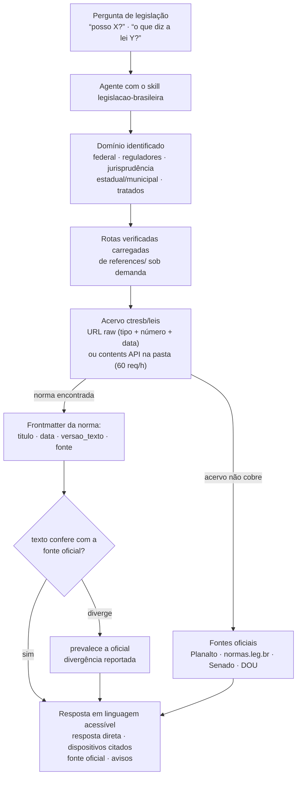

<div align="center">


### Rotas verificadas para buscar e citar a legislação brasileira — no seu agente de IA.

[](LICENSE)
[](https://agentskills.io)
[](https://github.com/ctresb/leis)
[]()

[Instalação](#instalação) · [Como funciona](#como-funciona) · [Fontes oficiais](#fontes-oficiais) · [Créditos](#créditos)

</div>

---

**leis** é um plugin no padrão [Agent Skills](https://agentskills.io) — adotado por Claude
(Claude Code e claude.ai), OpenAI Codex, Gemini CLI, GitHub Copilot, Cursor e Hermes — que
dá rotas verificadas para buscar e citar a legislação brasileira. Dado um assunto, o agente
sabe onde procurar o texto oficial — no acervo
[ctresb/leis](https://github.com/ctresb/leis) (mais de 320 mil normas em Markdown, busca
100% remota, sem clone) e nas fontes oficiais (Planalto, normas.leg.br, Congresso, Senado,
DOU) — e responde **citando a fonte publicada**, nunca só a conversão automática.

```text
"O que o CDC garante quando o produto vem com defeito?"
→ o agente localiza a Lei 8.078/1990 no acervo, cita os dispositivos aplicáveis
  (art. 18) e explica em linguagem acessível — com o link oficial da fonte.
```

> [!IMPORTANT]
> O texto do acervo é conversão automática das fontes oficiais (com OCR de documentos
> escaneados) e **não substitui a publicação no Diário Oficial**. Toda resposta cita a
> fonte oficial publicada (normalmente normas.leg.br) e, em caso de divergência, prevalece
> a oficial.

## Destaques

- 📖 **Respostas com base legal** — dado um assunto ("posso cancelar X?", "o que diz a lei
  Y?"), o agente localiza a norma, cita os dispositivos aplicáveis e explica em linguagem
  simples, sem juridiquês.
- 🔗 **Sempre com a fonte oficial** — toda resposta aponta a publicação oficial (normalmente
  normas.leg.br via URN LexML). O acervo é conversão automática e não substitui o DOU.
- 🗺️ **Rotas verificadas por domínio** — federal (leis, decretos, MPs, ECs), reguladores
  (ANVISA, CONTRAN, RFB…), jurisprudência (STF, STJ, TST), estadual/municipal e tratados,
  carregadas sob demanda — sem gastar tokens com o que o assunto não pede.
- ⚡ **Zero dependências** — busca remota via URL raw + API do GitHub; sem clone, sem índice
  local, sem chave de API.

## Instalação

### Claude Code

```text
/plugin marketplace add brunomalveira/leis
/plugin install leis@leis-br
```

Pronto. Pergunte ao Claude: *"A empresa não devolveu meu dinheiro — o que faço? Cite a lei."*

### claude.ai (Pro/Max)

1. Baixe o repositório (**Code ▸ Download ZIP**) e extraia.
2. Compacte apenas a pasta `skills/legislacao-brasileira/` — o `SKILL.md` deve ficar na
   raiz do zip.
3. Envie o zip em **Configurações › Capacidades (Capabilities) › Skills**.

### Codex, Cursor, Gemini CLI, GitHub Copilot e outros agentes

<details>
<summary><b>Copiar a pasta do skill (qualquer agente com suporte a Agent Skills)</b></summary>

Copie `skills/legislacao-brasileira/` para o diretório de skills do seu agente — o formato
é o [open standard Agent Skills](https://agentskills.io), então o mesmo conteúdo funciona
em Claude, Codex, Gemini CLI, GitHub Copilot, Cursor, Hermes e outros.

Em agentes que leem `AGENTS.md`, também basta apontar para este repositório: a AGENTS.md
direciona ao `SKILL.md`.

</details>

## Como funciona



| Peça | O que faz |
|---|---|
| Skill `legislacao-brasileira` | Ordem de consulta, como buscar no acervo, regra de citação e guia de resposta — carregado só quando o assunto é legislação |
| Rotas por domínio (`references/`) | Padrões de pasta e nomenclatura verificados por domínio (tabelas de tipos, exemplos confirmados), carregados sob demanda |
| Busca remota | URL raw direta (`raw.githubusercontent.com`) sabendo tipo + número + data, ou contents API na pasta — **60 requisições/hora sem token**; nunca clonar (~8,6 GB) |
| Regra de citação | Toda resposta aponta o campo `fonte:` do frontmatter da norma (normalmente normas.leg.br) ou o site oficial onde encontrou; divergência → prevalece a oficial |
| Guia de resposta | Estrutura em linguagem acessível: resposta direta → dispositivos citados com o texto fiel → base legal com link oficial → avisos (revogada, OCR, vigência) |

## Fontes oficiais

| Fonte | Papel | Link |
|---|---|---|
| **Acervo ctresb/leis** | Localizar a norma e ler o texto convertido — 323.849+ normas federais, estaduais, municipais e de reguladores, com frontmatter estruturado | [github.com/ctresb/leis](https://github.com/ctresb/leis) |
| **normas.leg.br** | A referência oficial citada — campo `fonte:` das normas federais (URN LexML) | [normas.leg.br](https://normas.leg.br/) |
| **Planalto** | Texto compilado oficial e regulamentos consolidados | [planalto.gov.br/legislacao](https://www.planalto.gov.br/legislacao) |
| **Congresso Nacional** | Propostas, MPs e atos do Congresso | [congressonacional.leg.br](https://www.congressonacional.leg.br/) |
| **Senado** | Legislação e jurisprudência do Senado | [www25.senado.leg.br](https://www25.senado.leg.br/) |
| **DOU** | A publicação oficial — o texto convertido do acervo não a substitui | [in.gov.br/servicos/diario-oficial-da-uniao](https://www.in.gov.br/servicos/diario-oficial-da-uniao) |

## Aviso

O plugin fornece **informações educativas e orientações gerais** baseadas em legislação
publicada. Não substitui a consulta a advogado (OAB), contador (CRC) ou outro profissional
habilitado. O texto do acervo é conversão automática das fontes oficiais (com OCR de
documentos escaneados) e não substitui a publicação no Diário Oficial — toda resposta do
agente traz a fonte oficial citada e, em caso de divergência, prevalece a oficial.

## Créditos

O acervo é o [**ctresb/leis**](https://github.com/ctresb/leis) — todo o conteúdo das buscas
vem dele: normas oficiais federais, estaduais, municipais e de reguladores convertidas para
Markdown com frontmatter estruturado, em atualização constante. O campo `fonte:` de cada
norma aponta à publicação oficial. O projeto **leis** apenas roteia a busca nesse acervo e
nas fontes oficiais — o conteúdo é do acervo.

Na comunidade, projetos relacionados:

- [mazulo/leis-mcp](https://github.com/mazulo/leis-mcp) — servidor MCP sobre o mesmo acervo
  ctresb/leis, com índice SQLite local
- [cristianoaredes/mcp-camara](https://github.com/cristianoaredes/mcp-camara) — MCP da API
  de Dados Abertos da Câmara dos Deputados
- [AlissonSantos1/brasil-legal-skills](https://github.com/AlissonSantos1/brasil-legal-skills) —
  plugin consultivo de direito brasileiro com calculadoras

## Licença

[MIT](LICENSE) — os termos do acervo ctresb/leis são os do próprio repositório.
